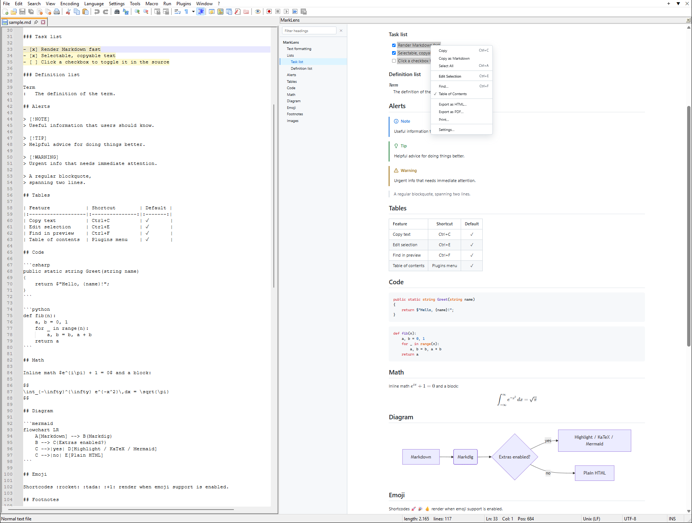

<div align="center">

# MarkLens

**A fast, modern Markdown preview for Notepad++**

Live preview · Table of contents · Jump from preview to source · Works with huge files

[](LICENSE)


[Features](#features) · [Install](#install) · [Usage](#usage) · [Settings](#settings) · [Contributing](#issues-and-contributions) · [Building](#building)



</div>

## Features

- **Select and copy anything** in the preview, with a right-click menu for Copy and Copy as Markdown.
- **Jump to the source.** Select text in the preview and choose *Edit Selection*. The cursor moves to the
  Markdown that produced it, and those lines are highlighted in the editor.
- **Table of contents** sidebar with a filter box. It highlights the section you are reading.
- **Two-way scroll sync** between the editor and the preview.
- **Clickable task lists**: ticking a box updates `[ ]` / `[x]` in your file.
- **Built for large files**: rendering runs in the background and only changed parts are redrawn.
- **Rich Markdown**: tables, footnotes, alerts (`> [!NOTE]`), definition lists, task lists, highlight,
  sub/superscript, abbreviations and more.
- **Optional extras**: code highlighting, Mermaid diagrams, KaTeX math and emoji, bundled so the preview
  works offline.
- **Light and dark themes** that follow Notepad++, plus your own stylesheet if you want one.
- **Export** to HTML or PDF, or print.

## Install

> [!NOTE]
> **Requirements:** Windows 10 or 11, **64-bit** Notepad++ 8.3.1 or later, .NET Framework 4.8 and the
> [Microsoft Edge WebView2 Runtime](https://developer.microsoft.com/microsoft-edge/webview2/). Current Windows
> versions include .NET Framework 4.8 and WebView2. Some older or LTSC installations may need WebView2 installed.

MarkLens is not yet available through Plugins Admin, so install it by hand:

1. Download `MarkLens-<version>-x64.zip` from the [Releases](https://github.com/maarten-grassmid/marklens/releases) page.
2. Close Notepad++.
3. Create the folder `C:\Program Files\Notepad++\plugins\MarkLens\` and extract the zip into it.
   `MarkLens.dll` should end up directly inside that folder. Writing to Program Files needs administrator rights.
4. Start Notepad++ and open **Plugins › MarkLens › Markdown Viewer**.

**Verify a download (optional):** every release zip carries a signed build attestation proving it was built by
this repository's GitHub workflow from the tagged source. With the [GitHub CLI](https://cli.github.com/) you can
check that a zip is genuine:

```powershell
gh attestation verify MarkLens-<version>-x64.zip --repo maarten-grassmid/marklens
```

**What's new:** each [release](https://github.com/maarten-grassmid/marklens/releases) lists its changes and the
SHA-256 of its zip.

**Uninstall:** close Notepad++ and delete `C:\Program Files\Notepad++\plugins\MarkLens\`. To also remove your
settings, delete `%AppData%\Notepad++\plugins\config\MarkLens\`.

**Try it:** open [`docs/sample.md`](docs/sample.md), which shows everything MarkLens can render.

## Usage

Open a Markdown file and press <kbd>Ctrl</kbd>+<kbd>Shift</kbd>+<kbd>M</kbd> to show or hide the preview.
You can dock the panel on any side or drag it out to float, and Notepad++ remembers where you put it.

| Action | How |
|---|---|
| Show / hide the preview | <kbd>Ctrl</kbd>+<kbd>Shift</kbd>+<kbd>M</kbd> or **Plugins › MarkLens › Markdown Viewer** |
| Jump to the Markdown behind a selection | Select, then right-click › **Edit Selection** or <kbd>Ctrl</kbd>+<kbd>E</kbd> |
| Jump to the Markdown behind a block | <kbd>Ctrl</kbd>+double-click it |
| Copy text / copy as Markdown | <kbd>Ctrl</kbd>+<kbd>C</kbd> / right-click › **Copy as Markdown** |
| Find in the preview | <kbd>Ctrl</kbd>+<kbd>F</kbd>, then <kbd>Enter</kbd> or <kbd>F3</kbd> |
| Go to a heading | Click it in the table of contents |
| Tick a task | Click its checkbox |
| Zoom | <kbd>Ctrl</kbd>+mouse wheel |
| Export or print | Right-click › **Export as HTML / PDF** or **Print** |

> [!TIP]
> The yellow source highlight stays while you move around inside it. It disappears when you click
> elsewhere, edit the text or switch documents.

## Settings

Open **Plugins › MarkLens › Settings…**

| Setting | Default |
|---|---|
| Theme (follow Notepad++, light, dark) | Follow Notepad++ |
| Table of contents | On |
| Synchronize scrolling | On |
| Markdown file extensions | `.md` `.markdown` `.mdown` `.mkd` and more |
| Live update delay | 250 ms |
| Custom stylesheet | None |
| Code highlighting · Mermaid · Math · Emoji | Off. The first three use libraries that ship inside the release; if one is missing, Settings marks it "not installed" and the preview keeps working without it. |
| Raw HTML in Markdown | Off (shown as text) |

Zoom level and the width of the table of contents are remembered automatically. All settings are stored in
`%AppData%\Notepad++\plugins\config\MarkLens\MarkLens.ini` (inside the Notepad++ folder for a portable install).

> [!NOTE]
> Raw HTML inside Markdown is shown as plain text by default, so a file cannot load remote images or embed
> other pages in the preview. Turn on **Render raw HTML** in Settings if your documents rely on it.

**Export as HTML** writes a single, self-contained file in the light theme. Code highlighting and diagrams are
kept as rendered. With Math on, the file loads the KaTeX fonts from a CDN so it stays a single file.

## Troubleshooting

| Problem | What to do |
|---|---|
| MarkLens is not in the Plugins menu, or Notepad++ reports it as incompatible | Check that you use **64-bit** Notepad++ 8.3.1 or later and that `MarkLens.dll` is directly inside `plugins\MarkLens\`. |
| The panel says the WebView2 runtime is required | Install the [WebView2 Runtime](https://developer.microsoft.com/microsoft-edge/webview2/) and restart Notepad++. |
| Code highlighting, Mermaid or Math is greyed out as "not installed" | A library is missing from the plugin folder. Reinstall the release zip. |
| "is not a Markdown file" | Add the file's extension in **Settings › Markdown file extensions**. |
| An error message appeared | Details are written to `%TEMP%\MarkLens.log`. Please include it when you open an issue. |

## Issues and contributions

Found a bug or have an idea? [Open an issue](https://github.com/maarten-grassmid/marklens/issues).

Pull requests are welcome. Branch from `develop` and target `develop`; `main` only receives releases, and
pull requests against it are rejected automatically. CI runs after the maintainer approves it, so a check
that says "waiting" on your pull request is normal. See [CONTRIBUTING.md](CONTRIBUTING.md) for the build
and test loop and for the few files that must change together.

## Building

You need **Windows**, **PowerShell** and the **.NET SDK 8 or newer**. The first build needs an internet
connection to restore NuGet packages and download the bundled client libraries.

```powershell
git clone https://github.com/maarten-grassmid/marklens.git
cd marklens

# build and package into dist\
.\tools\package.ps1

# or build, package and install into Notepad++ (run as administrator)
.\tools\package.ps1 -NppPluginsDir "C:\Program Files\Notepad++\plugins"

# install the package into a portable Notepad++ 8.3.1 and check that the viewer opens
# (closes every running Notepad++ first)
.\tools\smoke-test.ps1 -Zip dist\MarkLens-<version>-x64.zip
```

The libraries (highlight.js, KaTeX, Mermaid) are downloaded from npm into `src\MarkLens\assets\vendor\` and
verified against pinned checksums. After the build, `tools\DllExporter` adds the native entry points
Notepad++ needs to load the plugin.

**Releases:** every build runs the smoke test above against the packaged zip. Pushing a tag such as `v1.2.0`
on `main` builds the zip with that version, tests it the same way and publishes it as a GitHub release.

## License

MarkLens is released under the [MIT License](LICENSE).

It bundles Markdig, the WebView2 SDK, highlight.js, KaTeX and Mermaid, each under its own license. See
[THIRD-PARTY-NOTICES.txt](THIRD-PARTY-NOTICES.txt), which is also included in every release.
