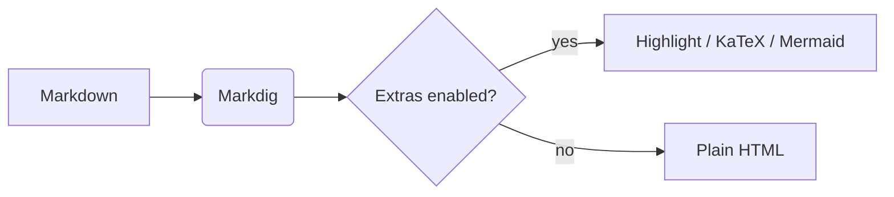

# MarkLens

A showcase of everything the viewer renders. Select any part of the preview,
right-click and choose **Edit Selection** to jump to the Markdown behind it.

## Text formatting

*Italic*, **bold**, ***bold italic***, ~~strikethrough~~, ==highlighted==,
++inserted++, H~2~O, E = mc^2^, `inline code` and <kbd>Ctrl</kbd>+<kbd>C</kbd>.

Autolinks: https://github.com/maarten-grassmid/marklens and a [relative link](../README.md).

Abbreviations like HTML are explained on hover.

*[HTML]: HyperText Markup Language

## Lists

1. First item
2. Second item
   - Nested bullet
   - Another one
     1. Deeper
3. Third item

### Task list

- [x] Render Markdown fast
- [x] Selectable, copyable text
- [ ] Click a checkbox to toggle it in the source

### Definition list

Term
:   The definition of the term.

## Alerts

> [!NOTE]
> Useful information that users should know.

> [!TIP]
> Helpful advice for doing things better.

> [!WARNING]
> Urgent info that needs immediate attention.

> A regular blockquote,
> spanning two lines.

## Tables

| Feature            | Shortcut        | Default |
|:-------------------|:---------------:|:-------:|
| Copy text          | Ctrl+C          | ✓       |
| Edit selection     | Ctrl+E          | ✓       |
| Find in preview    | Ctrl+F          | ✓       |
| Table of contents  | Plugins menu    | ✓       |

## Code

```csharp
public static string Greet(string name)
{
    return $"Hello, {name}!";
}
```

```python
def fib(n):
    a, b = 0, 1
    for _ in range(n):
        a, b = b, a + b
    return a
```

## Math

Inline math $e^{i\pi} + 1 = 0$ and a block:

$$
\int_{-\infty}^{\infty} e^{-x^2}\,dx = \sqrt{\pi}
$$

## Diagram



## Emoji

Shortcodes :rocket: :tada: :+1: render when emoji support is enabled.

## Footnotes

Here is a statement with a footnote.[^1]

[^1]: And this is the footnote text.

## Images


---

*End of sample.*
